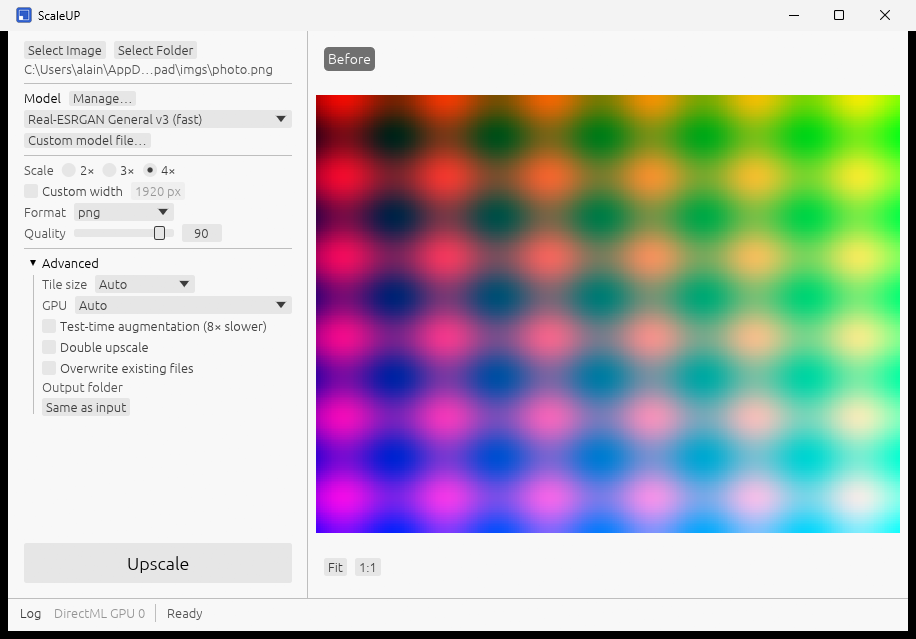
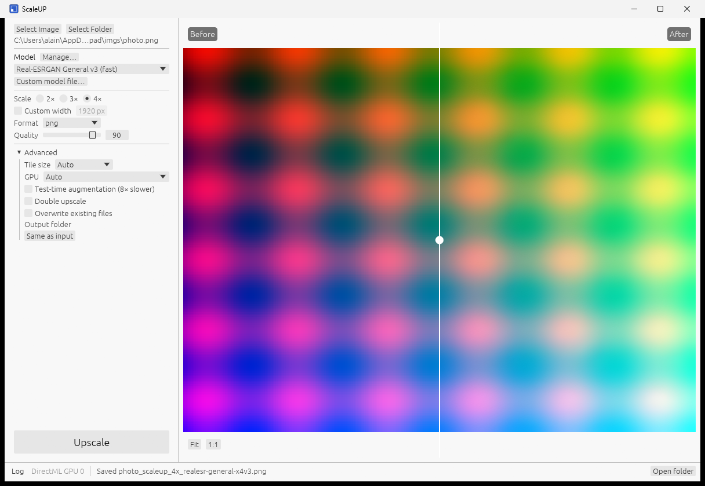
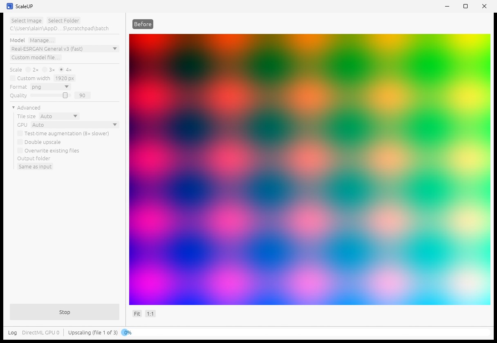

# ScaleUP

ScaleUP is an AI image upscaler written in Rust: a command line (`scaleup`) and a desktop app
(`scaleup-app`) that run Real-ESRGAN-family super-resolution models on the GPU through ONNX Runtime
(CUDA, DirectML, CoreML) or through a pure-Rust `wgpu` backend (Vulkan, Metal, DX12) that executes
ncnn `.param`/`.bin` models directly, with a CPU fallback. It is a rebuild inspired by
[Upscayl](https://github.com/upscayl/upscayl): the command line accepts the same flags as
`upscayl-bin`, so existing scripts keep working. Licensed under the AGPL-3.0-or-later.

## Screenshots

| Idle | Before/after comparison | Batch run |
|---|---|---|
|  |  |  |

More in [`docs/screenshots/`](docs/screenshots/).

## Install

Download the archive or installer for your platform from the
[Releases](https://github.com/inalto/scaleup/releases) page. Every archive contains `scaleup`,
`scaleup-app`, the ONNX Runtime provider libraries, `LICENSE`, this README and the model licenses.

| OS | Archive | Installer |
|---|---|---|
| Windows x64 | `scaleup-<version>-x86_64-pc-windows-msvc.zip` | `scaleup-<version>-x86_64-pc-windows-msvc.msi` |
| Linux x64 | `scaleup-<version>-x86_64-unknown-linux-gnu.tar.gz` | `scaleup_<version>_amd64.deb` |
| macOS (Apple Silicon and Intel) | `scaleup-<version>-macos.tar.gz` (universal CLI) | `scaleup-<version>-macos.dmg` |

Or build the command line from source:

```bash
cargo install --path crates/scaleup-cli
```

## Quick start

```bash
scaleup upscale -i in.jpg -o out/ -n realesrgan-x4plus
```

The model is downloaded and sha256-verified on first use. The output lands in `out/` as
`in_scaleup_4x_realesrgan-x4plus.png`. Run `scaleup models list` to see the catalogue and
`scaleup devices` to see which GPU will be used. The [user guide](docs/USER_GUIDE.md) covers every
option; [`docs/UPSCAYL_COMPAT.md`](docs/UPSCAYL_COMPAT.md) maps `upscayl-bin` flags to `scaleup`.

## GPU support

ONNX Runtime execution providers are tried in order and the first one that initialises wins
(CUDA → DirectML → CPU on Windows, CUDA → CPU on Linux, CoreML → CPU on macOS). ncnn models run on
the `wgpu` backend instead. A GPU that fails to initialise is a warning, not an error: the run
continues on the CPU.

| OS | NVIDIA | AMD | Intel | Apple |
|---|---|---|---|---|
| Windows | CUDA (ORT), DirectML (ORT), DX12/Vulkan (wgpu, ncnn models) | DirectML (ORT), DX12/Vulkan (wgpu) | DirectML (ORT), DX12/Vulkan (wgpu) | — |
| Linux | CUDA (ORT), Vulkan (wgpu, ncnn models) | Vulkan (wgpu, ncnn models); ONNX models on CPU | Vulkan (wgpu, ncnn models); ONNX models on CPU | — |
| macOS | — | — | — | CoreML (ORT), Metal (wgpu, ncnn models) |

CUDA needs the CUDA 12 and cuDNN 9 runtimes installed; without them ScaleUP falls through to the
next provider.

## Models

The catalogue is `models/manifest.json`; every model's license text is in `models/licenses/` and is
shown by `scaleup models info <id>`. Non-commercial models are listed but must be opted into.

| id | Scale | License | Commercial use |
|---|---|---|---|
| `realesr-general-x4v3` (default, fast) | 4× | BSD-3-Clause | yes |
| `realesrgan-x4plus` | 4× | BSD-3-Clause | yes |
| `realesrgan-x4plus-anime` | 4× | BSD-3-Clause | yes |
| `realesrgan-x2plus` | 2× | BSD-3-Clause | yes |
| `realesr-animevideov3` (very fast) | 4× | BSD-3-Clause | yes |
| `4xNomosUni_span_multijpg` | 4× | CC-BY-4.0 | yes |
| `4x-UltraSharp` | 4× | CC-BY-NC-SA-4.0 | no |
| `4x_foolhardy_Remacri` | 4× | CC-BY-NC-SA-4.0 | no |

Your own `.onnx` files work with `-n path/to/model.onnx`; folders of ncnn `.param`/`.bin` pairs
(for example an existing Upscayl models folder) are added with `scaleup models import <dir>`.

## Build from source

Rust 1.85 or newer (edition 2024). On Linux install the GTK and xdo development packages first:

```bash
sudo apt-get install libgtk-3-dev libxdo-dev
```

Then:

```bash
cargo build --release --workspace
cargo test --workspace
```

ONNX Runtime is downloaded by the `ort` crate at build time and its provider libraries are copied
next to the binaries in `target/release/`; keep them together when moving the executables.
Packaging scripts and installer sources are in [`packaging/`](packaging/) and
[`.github/workflows/release.yml`](.github/workflows/release.yml).

## License

ScaleUP is free software under the [GNU Affero General Public License v3.0 or later](LICENSE).

The models are not part of ScaleUP and keep their own licenses, listed above and in
`models/licenses/`. Models marked non-commercial (CC-BY-NC-SA-4.0) may not be used for commercial
purposes; it is your responsibility to check that a model's license allows your use of its output.
